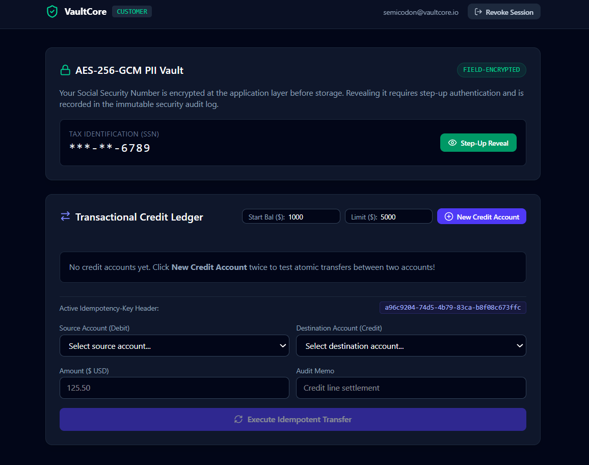
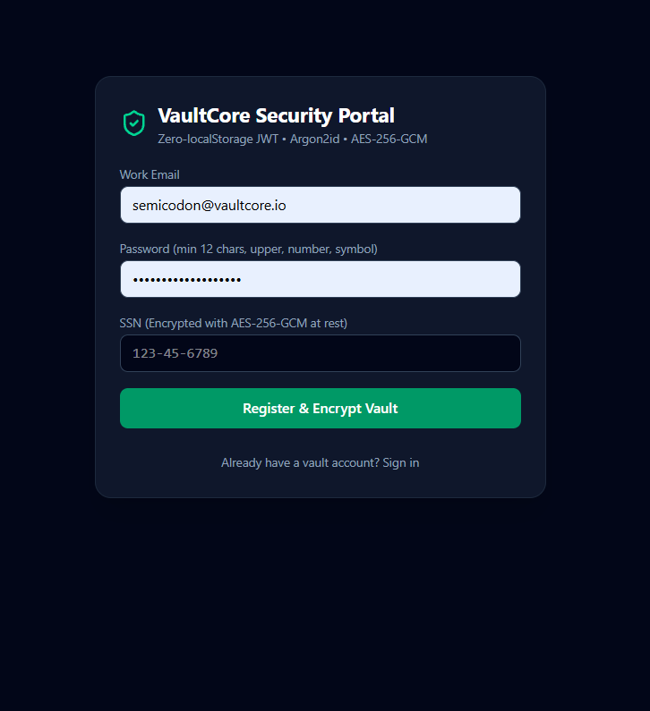
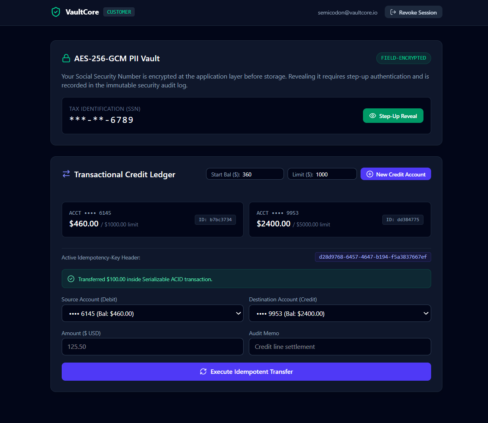

# 🛡️ VaultCore: Enterprise-Grade Full-Stack Security & FinTech Ledger

**VaultCore** is an educational yet production-grade full-stack banking and credit ledger platform built to demonstrate **Defense-in-Depth** security engineering. VaultCore treats security as a foundational architecture across all layers—from container isolation and cryptographic PII vaults to zero-trust session rotation, ACID-compliant double-entry ledgers, and automated adversarial testing.

---

## 🏗️ The 6-Phase Engineering Architecture

VaultCore was engineered across six progressive phases, moving from infrastructure hardening to preventive and detective security controls:

### [Phase 1: Hardened Infrastructure & Container Security](../docker-compose.yml)
* **Loopback Isolation:** PostgreSQL and Redis containers bind strictly to `127.0.0.1`, preventing exposure to external networks or misconfigured host firewalls.
* **Privilege Restrictions:** Containers run with `no-new-privileges:true` and strict memory/CPU resource limits to mitigate container breakout and Denial-of-Service (DoS) attacks.
* **Modern Cryptography:** Enforces `scram-sha-256` database authentication and strips dangerous administrative commands (`FLUSHALL`, `CONFIG`) from Redis.

### [Phase 2: Data-Layer Security & PII Vault Engine](../backend/src/utils/crypto.ts)
* **Field-Level Encryption (`AES-256-GCM`):** Sensitive PII (Social Security Numbers, account numbers) is encrypted in Node.js with unique 96-bit IVs and authentication tags *before* reaching PostgreSQL.
* **Fail-Fast Environment Validation:** Zod validates cryptographic keys and connection strings at startup (`env.ts`), aborting execution (`process.exit(1)`) if any secret is malformed.
* **Immutable Double-Entry Ledger:** Financial transactions are stored as append-only `LedgerEntry` rows in integer cents to eliminate floating-point rounding errors.

### [Phase 3: Hardened Express Server, Redis Rate Limiting & Zero-Trust Auth](../backend/src/routes/auth.routes.ts)
* **HttpOnly Token Rotation:** Short-lived access tokens (15-min RAM closure) paired with rotating refresh tokens locked inside `HttpOnly; SameSite=Strict` cookies.
* **Redis JTI Revocation:** Each refresh token carries a unique session ID (`jti`) tracked in Redis, allowing instant revocation on logout or reuse detection.
* **Distributed Rate Limiting:** Redis-backed rate limiters protect public endpoints (100 req/15m) and brute-force auth routes (5 req/15m).

### [Phase 4: ACID Transactions, Idempotency & Step-Up PII Decryption](../backend/src/routes/accounts.routes.ts)
* **Serializable ACID Transfers:** Financial ledger transfers execute inside strict Prisma `prisma.$transaction` blocks with `Serializable` isolation to prevent race conditions and double-spending.
* **Idempotency Keys:** Client-provided UUID headers guarantee that network retries or double-clicks never double-charge an account.
* **Step-Up Authentication:** Decrypting sensitive PII requires re-authenticating with the user's master password alongside `Cache-Control: no-store` headers.

### [Phase 5: Secure Frontend Architecture & Auto-Masking PII UI](../frontend/src/App.tsx)
* **In-Memory Auth State:** Tokens never touch `localStorage` or `sessionStorage`, rendering browser XSS token-scraping ineffective.
* **Silent Interceptor & F5 Recovery:** Automatically intercepts `401 Unauthorized` responses and refreshes access tokens in the background without UI interruption.
* **Self-Destructing PII Vault:** Automatically re-masks plaintext SSNs when the browser tab loses visibility (`visibilitychange` API) or after a 15-second inactivity timeout.

### [Phase 6: Security Operations Center (SOC) & Automated Testing](../backend/src/__tests__/security.test.ts)
* **Circuit-Breaker Account Freezing:** Non-destructive account suspension (`isFrozen = true`) that halts ledger transfers while preserving forensic evidence.
* **Tamper-Evident Audit Logs:** Generates deterministic `SHA-256` integrity fingerprints across audit log columns to detect unauthorized database tampering.
* **Automated Adversarial Testing:** A comprehensive test suite (`Vitest` + `Supertest`) validating ciphertext integrity, header hardening, JWT forgery rejection, and RBAC enforcement.

---

## 🚀 Quick Start Guide

### Prerequisites
* Node.js (v20+ recommended)
* Docker & Docker Compose
* Git

### 1. Clone & Set Up Environment Secrets
```bash
git clone https://github.com/your-username/vaultcore-security.git
cd vaultcore-security

# Copy environment templates
cp .env.example .env
cp backend/.env.example backend/.env

# Generate a 32-byte hex encryption key and update ENCRYPTION_KEY in .env
openssl rand -hex 32
```

### 2. Launch Hardened Infrastructure (Postgres & Redis)
```bash
docker compose up -d
docker compose ps # Verify both containers report "(healthy)"
```

### 3. Start the Backend API
```bash
cd backend
npm install
npx prisma generate
npx prisma migrate dev --name init_security_ledger_schema
npm run dev
```

### 4. Start the Frontend Application
```bash
cd ../frontend
npm install
npm run dev
```
Open your browser at `http://localhost:5173`.

---

## 🧪 Running the Automated Security Test Suite
VaultCore includes an adversarial test suite that simulates database tampering, JWT forgery, and RBAC bypasses.

```bash
cd backend
npm test
```

---

## 🛡️ Security Compliance & Threat Modeling

| Threat Vector | Mitigation Strategy | Implementation |
| :--- | :--- | :--- |
| **XSS Token Theft** | No `localStorage` usage | In-memory JavaScript closure state + `HttpOnly` refresh cookies. |
| **SQL Injection & Data Leaks** | Application-layer encryption + Prisma ORM | `AES-256-GCM` encryption engine (`crypto.ts`) and parameterized queries. |
| **Double-Spend Race Conditions** | Serializable isolation levels | Prisma transactional locks (`prisma.$transaction`). |
| **Mass Assignment Privilege Escalation** | Out-of-band role provisioning | Zod strict validation on registration + internal CLI script (`promote-admin.ts`). |
| **Audit Log Tampering** | Cryptographic hashing | Deterministic `SHA-256` canonical row fingerprinting. |

---







